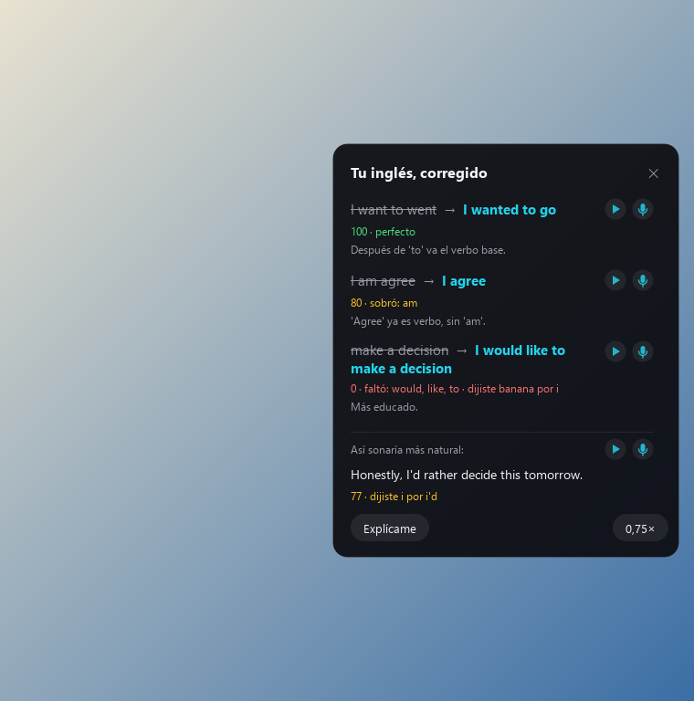
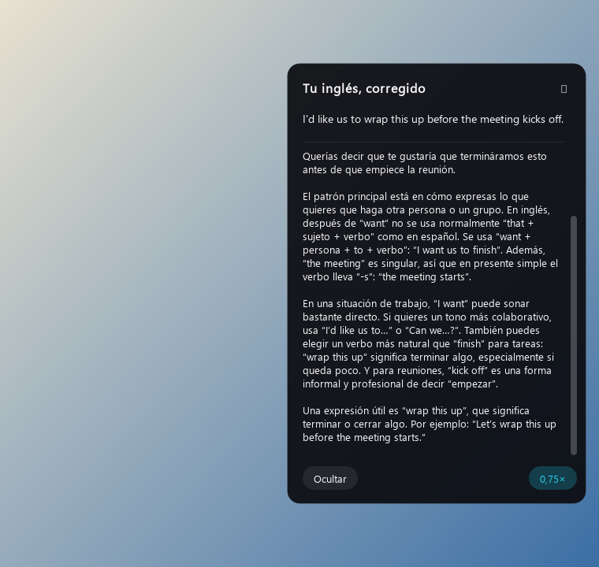

<p align="center">
  
</p>

<p align="center">
  Voice dictation for Windows. Speak, release the keys, and the cleaned-up text lands wherever your cursor is.
</p>

---

## What it is

fluentpill sits in the background on Windows. You hold a hotkey, talk, and let go. It transcribes what you said with Whisper, removes the filler and false starts with a language model, and pastes the result into whatever app you have open: your editor, a browser tab, a chat, an email.

It also has an English practice mode. You say something in English, and fluentpill pastes the corrected version and keeps a record of what you got wrong, so you can see which mistakes keep coming back.

It is a fork of [SFlow](https://github.com/daniel-carreon/sflow) by Daniel Carreón, rebuilt around Windows. See [Credits](#credits).

## English mode

Press **Ctrl+Alt+Space**, speak English, and press it again. fluentpill pastes your sentence corrected and opens a small panel with what it changed:

- **The corrections**, one by one, with a short reason for each (grammar, vocabulary, naturalness).
- **▶ Native voice.** Plays the corrected sentence with a natural voice, so you hear how it should sound.
- **🎤 Shadowing.** You repeat the sentence out loud, and the panel scores how close you got and tells you which words slipped.
- **Explain.** A short mini-lesson about your sentence: why the fix works and a similar expression worth learning. (The lesson is written in Spanish.)
- **0.75×.** Plays the native voice at 75% speed without changing the pitch.
- **Repeated mistakes.** A tab in the web dashboard shows your most common errors over the last 7 or 30 days, or all time.

<p align="center">
  
  
</p>

The panel and the lessons are in Spanish today. Everything you dictate in English mode is saved locally in SQLite.

## Normal dictation

| Action | Keys |
| --- | --- |
| Push to talk | Hold **Ctrl+Shift**, speak, release |
| Hands-free | Press **Ctrl+Space**, speak, press it again |
| Paste the last cleaned text again | **Alt+Shift+Z** |
| Paste the last raw transcription (before cleaning) | **Ctrl+Shift+R** |

While you talk, a floating pill shows the state. It does not steal focus from the window you are typing in.

Other things it does:

- Adapts tone to the app in the foreground (email, chat, code, notes), using only the app name and a category.
- Learns names and technical terms from your corrections and feeds them to Whisper next time.
- Mutes its shortcuts while a fullscreen game or video is focused. The tray icon still works.
- Falls back to a second transcription provider if the first one fails or times out.
- Keeps a searchable history of your dictations in a local web page at `http://localhost:5000`.
- Has an optional watchdog that restarts it if it crashes.

## Requirements

- Windows 10 or 11.
- Python 3.12 or newer.
- A microphone.
- At least one API key. Which ones you need depends on what you use:
  - [Groq](https://console.groq.com/keys): transcription and text cleaning.
  - [OpenAI](https://platform.openai.com/api-keys): transcription and text cleaning. It is the default transcriber when its key is set.
  - [Google AI Studio (Gemini)](https://aistudio.google.com/apikey): text cleaning, and the native voice in English mode.

macOS code paths from SFlow are still in the repository, but only Windows is tested and the English mode is Windows only.

## Install

```bat
git clone https://github.com/NestorPVsf/fluentpill.git
cd fluentpill

python -m venv venv
venv\Scripts\pip install -r requirements.txt

copy .env.example .env.local
notepad .env.local
```

Paste your keys into `.env.local` (see [Configuration](#configuration)), then start it:

```bat
fluentpill.bat
```

`fluentpill.bat` launches the app without a console window. To see the logs live, run `venv\Scripts\python.exe main.py` instead.

To start it with Windows, run `install-autostart.bat` once. `uninstall-autostart.bat` undoes it. `fluentpill-stop.bat` stops it for good, and `install-watchdog.bat` adds the optional watchdog.

Data and logs live in `%LOCALAPPDATA%\fluentpill`. If you used an older build, its `%LOCALAPPDATA%\Howl` folder is renamed on the first start.

## Configuration

Everything is read from environment variables, loaded from `.env` and then `.env.local` in the repository folder. `.env.example` lists them all. The ones you will touch first:

| Variable | What it does |
| --- | --- |
| `GROQ_API_KEY` | Groq key (Whisper and the cleaner fallback) |
| `OPENAI_API_KEY` | OpenAI key (transcription and cleaning) |
| `GEMINI_API_KEY` | Gemini key (cleaning, and the English voice) |
| `WHISPER_LANGUAGE` | Language hint such as `es` or `en`. Leave empty to auto-detect |
| `ASR_PRIMARY` | Which provider transcribes first: `openai` (default) or `groq` |
| `CLEANER_ENABLED` | Set to `false` to paste the raw transcription without cleaning |
| `ENGLISH_MODE_HOTKEY` | Chord for English mode. Empty turns the mode off |
| `APP_CONTEXT_SEND_TITLE` | Off by default. When `true`, the window title is sent to the cleaner |
| `SAVE_RECORDINGS` | Keep recent audio on disk for debugging. Off with `false` |

The prompts that drive the cleaner and the English corrections are plain Markdown files in `prompts/`. Edit them to change the style.

## Privacy

fluentpill has no server of its own. Your audio and text go straight from your computer to the providers you configured, and nowhere else.

| What | Sent to |
| --- | --- |
| Your recorded audio | Groq or OpenAI, for transcription |
| The transcribed text, plus the name and category of the foreground app | Gemini, OpenAI or Groq, to clean it |
| In English mode, your sentence | OpenAI or Groq for the corrections and the Explain lesson |
| In English mode, the corrected sentence | Gemini, to generate the native voice |
| The window title | Nobody, unless you set `APP_CONTEXT_SEND_TITLE=true` |

Stored on your machine:

- The history database, `transcriptions.db`, in the repository folder. It holds your dictations and your English corrections.
- Recent audio files in `%LOCALAPPDATA%\fluentpill`, deleted after 24 hours by default. Turn it off with `SAVE_RECORDINGS=false`.
- Your keys, in `.env.local`. Git ignores that file; keep it that way.

Each provider has its own data policy. Read it before you dictate anything sensitive.

## Tests

The tests in `tools/` that do not need the network run with:

```bat
set QT_QPA_PLATFORM=offscreen
venv\Scripts\python.exe tools\test_english_popup.py
```

Replace the file name with any other `tools\test_*.py`.

## Credits

fluentpill is forked from [SFlow](https://github.com/daniel-carreon/sflow) by [Daniel Carreón](https://github.com/daniel-carreon), released under the MIT license. The Windows version and the English mode are by [Néstor Martínez](https://github.com/NestorPVsf).

## License

MIT. See [LICENSE](LICENSE). It keeps the original copyright notice from SFlow, as the license requires.
